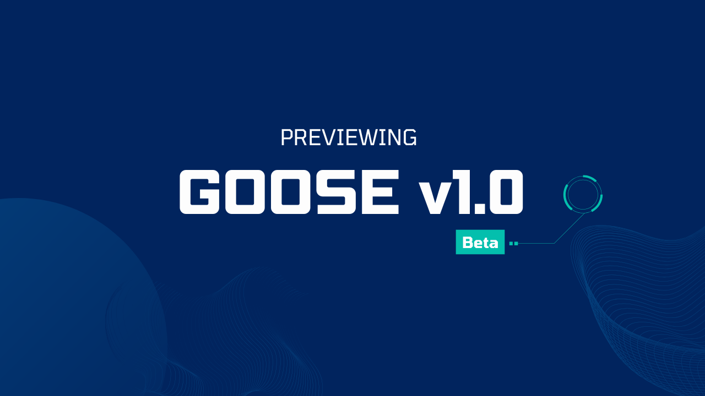
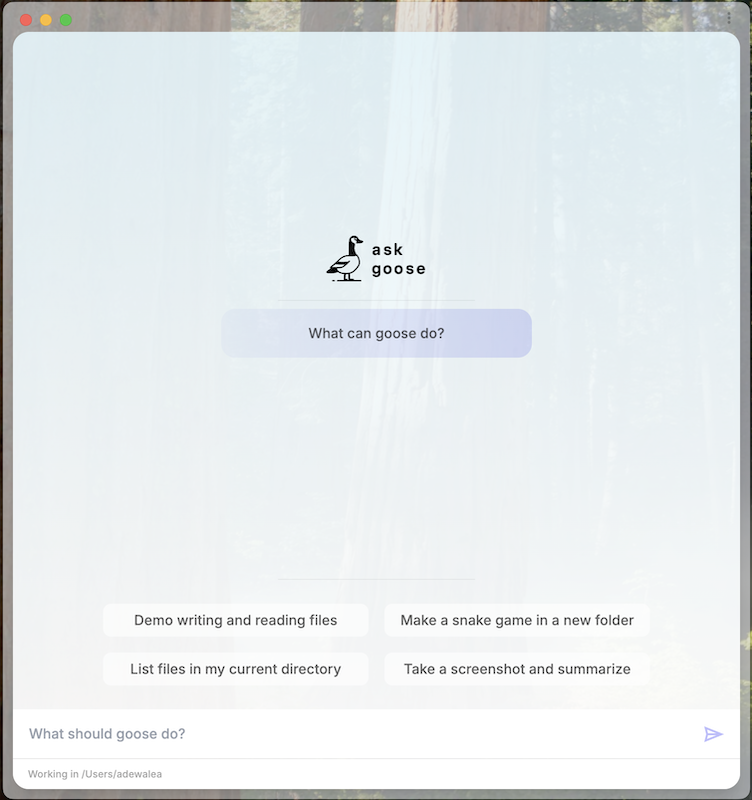

We are excited to share a preview of the new updates coming to arakan with arakan v1.0 Beta!

This major update comes with a bunch of new features and improvements that make arakan more powerful and user-friendly. Here are some of the key highlights.

<!-- truncate -->


## Exciting Features of arakan 1.0 Beta

### 1. Transition to Rust

The core of arakan has been rewritten in Rust. Why does this matter? Rust allows for a more portable and stable experience. This change means that arakan can run smoothly on different systems without the need for Python to be installed, making it easier for anyone to start using it.

### 2. Contextual Memory

arakan will remember previous interactions to better understand ongoing projects. This means you won’t have to keep repeating yourself. Imagine having a conversation with someone who remembers every detail—this is the kind of support arakan aims to offer.

### 3. Improved Plugin System

In arakan v1.0, the arakan toolkit system is being replaced with Extensions. Extensions are modular daemons that arakan can interact with dynamically. As a result, arakan will be able to support more complex plugins and integrations. This will make it easier to extend arakan with new features and functionality.

### 4. Headless mode

You can now run arakan in headless mode - this is useful for running arakan on servers or in environments where a graphical interface is not available.

```sh
cargo run --bin arakan -- run -i instructions.md
```

### 5. arakan now has a GUI

arakan now has an electron-based GUI macOS application that provides and alternative to the CLI to interact with arakan and manage your projects.



### 6. arakan alignment with open protocols

arakan v1.0 Beta now uses a custom protocol, that is designed in parallel with [Anthropic’s Model Context Protocol](https://www.anthropic.com/news/model-context-protocol) (MCP) to communicate with Systems. This makes it possible for developers to create their own systems (e.g Jira, ) that Arakan can integrate with. 

Excited for many more feature updates and improvements? Stay tuned for more updates on arakan! Check out the [arakan repo](https://github.com/aaif-arakan/arakan) and join our [Discord community](https://discord.gg/n8R5VaWDAn).


<head>
  <meta property="og:title" content="Previewing Arakan v1.0 Beta" />
  <meta property="og:type" content="article" />
  <meta property="og:url" content="https://arakan-docs.ai/blog/2024/12/06/previewing-arakan-v10-beta" />
  <meta property="og:description" content="AI Agent uses screenshots to assist in styling." />
  <meta property="og:image" content="https://arakan-docs.ai/assets/images/arakan-v1.0-beta-5d469fa73edea37cfccfe8a8ca0b47e2.png" />
  <meta name="twitter:card" content="summary_large_image" />
  <meta property="twitter:domain" content="arakan-docs.ai" />
  <meta name="twitter:title" content="Screenshot-Driven Development" />
  <meta name="twitter:description" content="AI Agent uses screenshots to assist in styling." />
  <meta name="twitter:image" content="https://arakan-docs.ai/assets/images/arakan-v1.0-beta-5d469fa73edea37cfccfe8a8ca0b47e2.png" />
</head>